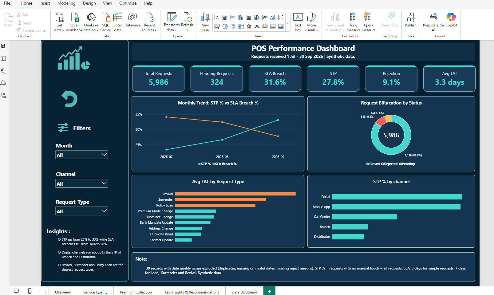
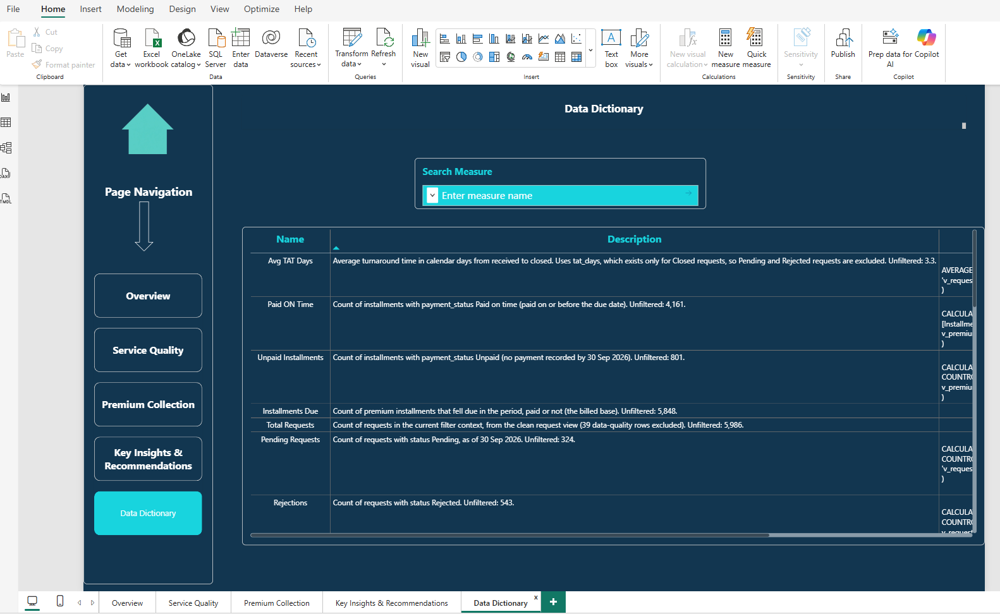

# POS Performance Dashboard \| Power BI & MySQL

An end-to-end business intelligence portfolio project focused on
operational performance, service-level compliance, request rejections,
backlog ageing, and premium collection. **MySQL Workbench and SQL** were
used to clean and validate data and create analytical views; **Power BI
Desktop and DAX** were used to build the semantic model, KPIs,
interactive report pages, and business recommendations.

> **Data disclaimer:** This project uses synthetic data. The findings
> and recommendations are illustrative and should not be interpreted as
> actual company performance.

## Table of Contents

1.  [Project Overview](#project-overview)
2.  [Business Problem](#business-problem)
3.  [Project Objectives](#project-objectives)
4.  [Tools and Technologies](#tools-and-technologies)
5.  [Data and Quality Handling](#data-and-quality-handling)
6.  [Dashboard Walkthrough](#dashboard-walkthrough)
    -   [Page 1: Overview](#page-1-overview)
    -   [Page 2: Service Quality](#page-2-service-quality)
    -   [Page 3: Premium Collection](#page-3-premium-collection)
    -   [Page 4: Key Insights and
        Recommendations](#page-4-key-insights-and-recommendations)
    -   [Page 5: Data Dictionary](#page-5-data-dictionary)
7.  [Key Metrics and Definitions](#key-metrics-and-definitions)
8.  [Key Findings](#key-findings)
9.  [Business Recommendations](#business-recommendations)
10. [Technical Approach](#technical-approach)
11. [Repository Structure](#repository-structure)
12. [How to Use the Project](#how-to-use-the-project)
13. [Limitations and Assumptions](#limitations-and-assumptions)
14. [Author](#author)

------------------------------------------------------------------------

## Project Overview

The POS Performance Dashboard is an interactive Power BI report for
reviewing operational performance across Point of Sale service requests
and premium collections.

The report covers **1 July--30 September 2026** and brings together
request volumes, turnaround time, SLA breaches, straight-through
processing (STP), rejection reasons, pending-request ageing, premium
payment outcomes, and improvement recommendations.

The project follows a SQL-to-Power BI workflow: data cleaning and
validation in MySQL Workbench, analytical views for reporting, DAX
measures for KPIs, and a multi-page Power BI report with navigation and
filters.

## Business Problem

Operations teams need a consistent view of service performance to
understand where requests are delayed, why requests are rejected, how
effectively requests are processed without manual intervention, and
where premium payments remain unpaid.

The dashboard is designed to help answer questions such as:

-   How are request volume and key operational KPIs performing?
-   Is STP improving while SLA breaches are declining?
-   Which request types and channels have the highest SLA breach rates?
-   What are the most common rejection reasons?
-   How many requests remain pending beyond seven days?
-   How much premium is due, paid on time, or unpaid?
-   Which findings should be prioritized for process improvement?

## Project Objectives

-   Clean and validate source data using SQL in MySQL Workbench.
-   Create SQL views for analysis-ready datasets.
-   Build operational and premium-collection KPIs using DAX.
-   Compare performance across months, channels, request types,
    rejection reasons, and premium categories.
-   Identify process bottlenecks and potential improvement
    opportunities.
-   Present recommendations with proposed success metrics.
-   Document selected measures and their business definitions.

## Tools and Technologies

  -----------------------------------------------------------------------
  Tool / Technology                   Use in the project
  ----------------------------------- -----------------------------------
  MySQL Workbench                     SQL development, data cleaning,
                                      validation, and view creation

  SQL                                 Data-quality checks and preparation
                                      of analytical views

  Power BI Desktop                    Data model, report pages,
                                      visualizations, filters, and
                                      navigation

  DAX                                 KPI calculations, ratios, counts,
                                      averages, and currency-scaled
                                      values

  Power Query                         Loading and shaping data for the
                                      Power BI model, where used

  TMDL                                Inspection and documentation of
                                      semantic-model measure definitions

  Python                              Synthetic POS/request data
                                      generation, via
                                      `generate_pos_data.py`
  -----------------------------------------------------------------------

## Data and Quality Handling

The dashboard uses **synthetic data** for **1 July--30 September 2026**.
The report notes that **39 records with data-quality issues were
excluded** from the clean request population. The issue categories noted
in the report include duplicates, missing or invalid dates, and missing
rejection reasons.

The request-related measures use `v_request_clean`; premium metrics use
`v_premium_detail`. The unfiltered request population shown in the
report is **5,986 records** after the noted exclusions.

The README does not infer additional cleaning rules beyond those
documented in the report and supplied model definitions. Review the SQL
scripts in the `SQL queries` folder for the implemented logic.

## Dashboard Walkthrough

### Page 1: Overview



The overview page summarizes the main operational KPIs and highlights
the monthly movement in STP and SLA performance.

**KPIs shown:**

-   Total Requests: **5,986**
-   Pending Requests: **324**
-   SLA Breach: **31.6%**
-   STP: **27.8%**
-   Rejection: **9.1%**
-   Average TAT: **3.3 days**

**Visuals and interactions include:**

-   Monthly trend: STP % versus SLA Breach %.
-   Request bifurcation by status.
-   Average turnaround time by request type.
-   STP % by channel.
-   Filters for month, channel, and request type.
-   An insight panel and a note describing the synthetic data and key
    metric context.

### Page 2: Service Quality


This page examines SLA breaches, rejection patterns, and the ageing of
pending requests.

**KPIs shown:**

-   SLA Breaches: **1,618**
-   Pending Requests older than 7 days: **20**
-   Rejections: **543**
-   Top Rejection Share: **48.1%**

**Visuals and interactions include:**

-   SLA breach % by request type.
-   SLA breach % by channel.
-   Rejections by rejection reason.
-   Pending requests by age bucket.
-   STP % by received month and channel.
-   STP % by channel and month.
-   Month, channel, and request-type filters, plus a Clear Filters
    control.

### Page 3: Premium Collection


This page focuses on premium installments due, payment timeliness,
unpaid installments, and unpaid amounts.

**KPIs shown:**

-   Installments Due: **5,848**
-   Premium Due Amount: **₹18.52 crore**
-   Paid On Time %: **71.2%**
-   Unpaid %: **13.7%**
-   Unpaid Amount: **₹2.39 crore**

**Visuals include:**

-   Collection Rate versus an illustrative target.
-   Premium collection breakdown: paid on time, paid late, unpaid, and
    total.
-   Unpaid premium by status and plan.
-   Unpaid % by premium mode and due month.
-   Plan risk: premium billed versus unpaid %.
-   Top 10 unpaid installments on in-force policies.

### Page 4: Key Insights and Recommendations


This page consolidates selected findings and translates them into
prioritized actions. It also includes a recommendation table with
proposed success metrics and an example of how a business requirement
can be expressed at BRD, FRD, and FSD levels.

The report highlights:

-   STP rose from **23.4% to 33.2%** across the three-month period.
-   Revival requests had the highest displayed SLA breach rate, at
    approximately **69%**.
-   The report states that around **70% of unpaid premium (₹1.68 crore
    of ₹2.39 crore) sits on lapsed policies**.

The recommendation table proposes operational changes; its success
metrics are targets, not measured results.

### Page 5: Data Dictionary



The Data Dictionary provides searchable measure names and business
descriptions. The supplied TMDL includes definitions for selected
measures such as average turnaround time, on-time payments, unpaid
installments, installments due, total requests, pending requests, and
rejections.

This page helps users find metric definitions and interpret the measures
consistently.

## Key Metrics and Definitions

The following definitions are based on the supplied TMDL measure
expressions and descriptions.

  -----------------------------------------------------------------------
  Metric                              Definition used in the report
  ----------------------------------- -----------------------------------
  Total Requests                      Count of rows in `v_request_clean`
                                      in the current filter context

  Pending Requests                    Count of clean request rows with
                                      status `Pending`

  STP %                               Requests with `stp_flag = "Y"`
                                      divided by all rows in
                                      `v_request_clean`

  Rejection %                         Requests with status `Rejected`
                                      divided by all clean requests

  Avg TAT Days                        Average of `tat_days`; pending and
                                      rejected requests without a
                                      recorded TAT are excluded

  SLA Breach %                        Average of the `sla_breach` flag;
                                      blank values are ignored

  SLA Breaches                        Sum of the `sla_breach` flag,
                                      described in the report as closed
                                      requests whose TAT exceeded their
                                      SLA target

  Pending \> 7 days                   Pending requests where
                                      `age_days > 7`

  Top Rejection Share                 Requests with rejection reason
                                      `Policy not in force` divided by
                                      all rejected requests; this is a
                                      fixed reason-specific measure

  Installments Due                    Count of rows in
                                      `v_premium_detail`, representing
                                      installments due whether paid or
                                      unpaid

  Premium Due                         Sum of premium amount divided by
                                      10,000,000, for display in crore
                                      rupees

  Paid On Time                        Count of installments with
                                      `payment_status = "Paid on time"`

  Paid On Time %                      Paid-on-time installments divided
                                      by all installments due

  Unpaid Installments                 Count of installments with
                                      `payment_status = "Unpaid"`

  Unpaid %                            Unpaid installments divided by all
                                      installments due

  Unpaid Amount                       Sum of amounts for unpaid
                                      installments divided by 10,000,000

  Collection Rate                     `1 - Unpaid %`; this is the share
                                      not classified as unpaid, not the
                                      on-time payment rate

  Collection Target                   Illustrative 90% gauge target; TMDL
                                      explicitly says this is not a
                                      company target
  -----------------------------------------------------------------------

**Metric interpretation note:** STP, rejection, SLA breach, and payment
measures have different denominators. They should not be treated as
interchangeable rates. For example, **Paid On Time % is 71.2%**, while
the report's **Collection Rate is 86.3%**, because Collection Rate is
defined as one minus the unpaid share.

## Key Findings

These observations are based on the displayed report and should be
interpreted as findings from synthetic data.

1.  **STP improved over the reporting period.** The overall STP rate
    rose from **23.4% in July to 33.2% in September**.
2.  **Revival requests are a major SLA concern.** Their displayed SLA
    breach rate is approximately **69.3%**, the highest among the
    request types shown.
3.  **Channel performance differs substantially.** The report shows
    higher STP rates for Portal and Mobile App than for Branch and
    Distributor.
4.  **"Policy not in force" is the largest displayed rejection reason.**
    The fixed DAX measure reports **48.1% of rejections** for this
    reason.
5.  **A backlog remains beyond seven days.** The report shows **20
    pending requests** older than seven days.
6.  **Unpaid premium warrants segmentation and follow-up.** The premium
    page shows **₹2.39 crore** in unpaid installments; the insights page
    highlights unpaid premium associated with lapsed policies.

## Business Recommendations

The report proposes the following improvement directions. These are **proposed actions and targets**, not measured outcomes.

| Priority | Recommendation | Proposed Success Metric |
|:---:|---|---|
| **1** | Add eligibility and policy-status checks at request capture. | Reduce the displayed rejection rate from **9.1%**. |
| **2** | Add a document checklist with automatic validation. | Reduce capture-related rejections by half. |
| **3** | Move Branch and Distributor submissions toward digital capture. | Increase STP above **40%** in these channels. |
| **4** | Redesign the Revival process with a priority queue. | Reduce the Revival SLA breach rate below **40%**. |
| **5** | Run retention outreach for in-force policies with unpaid premium. | Reduce the unpaid share on in-force policies below the proposed **3%** threshold. |
| **6** | Create a daily ageing report for pending requests older than seven days. | Reach zero requests older than seven days. |
| **7** | Confirm SLA targets, then automate or reset targets for selected request types. | Reduce SLA breach rates for Premium Mode Change, Nominee Change, and Bank Mandate Update below **25%**. |


## Technical Approach

1.  **Inspect and prepare data in MySQL Workbench.** Use SQL to
    investigate data quality, clean and validate the source data, and
    prepare analysis-ready views.
2.  **Create SQL views.** Provide structured datasets for request
    analysis and premium installment analysis. The supplied DAX
    references `v_request_clean` and `v_premium_detail`.
3.  **Load data into Power BI.** Use the prepared datasets as the source
    for the report model.
4.  **Create DAX measures.** Define KPIs, ratios, counts, averages, and
    currency-scaled values. Selected measure descriptions are documented
    in the supplied TMDL.
5.  **Build report pages.** Organize the report into overview, service
    quality, premium collection, recommendations, and data dictionary.
6.  **Validate displayed values.** Compare unfiltered KPI results with
    measure definitions and report totals.
7.  **Translate findings into actions.** Pair observations with
    operational recommendations and proposed success metrics.

## Repository Structure

The following reflects the main items visible in the current project
folder. The contents inside each folder may include additional files.

``` text
POS-Performance-Dashboard/
├── README.md
├── POS_Dashboard.pbix
├── generate_pos_data.py
├── policy_dataset/
├── SQL queries/
└── screenshots/
    ├── 01-overview.png
    ├── 02-service-quality.png
    ├── 03-premium-collection.png
    ├── 04-key-insights-recommendations.png
    └── 05-data-dictionary.png
```

Keep the screenshot paths and names in this README aligned with the
actual files committed to GitHub. The `image.png` screenshot showing
Windows File Explorer is not included in the dashboard walkthrough
because it is not a report page.

## How to Use the Project

1.  Clone or download the repository.
2.  Review the SQL scripts in `SQL queries` and adapt database
    references to your MySQL environment if needed.
3.  Run the SQL scripts in the intended order after configuring the
    required source data.
4.  Open `POS_Dashboard.pbix` in Power BI Desktop.
5.  If prompted, configure the data source connection and refresh the
    model.
6.  Use the report navigation and filters to explore the pages.

**Prerequisites:** MySQL Workbench with access to the project database,
and Power BI Desktop. Refreshing the PBIX requires the relevant source
data and a working connection. The README and screenshots can be
reviewed without connecting to the database.

## Limitations and Assumptions

-   The dataset is synthetic and findings are illustrative.
-   The reporting period is 1 July--30 September 2026.
-   The report states that 39 data-quality records were excluded from
    the request population.
-   The 90% collection target is illustrative, not a verified company
    target.
-   `Top Rejection Share` is fixed to `Policy not in force`; it does not
    automatically switch to whichever rejection reason ranks first.
-   `Avg TAT Days` uses `tat_days`, described as populated for closed
    requests; results depend on the source field and current filter
    context.
-   Recommendations are proposed actions, not evidence that changes were
    implemented or targets achieved.
-   Full source schemas, transformation logic, and model relationships
    should be reviewed in the SQL scripts and project files where
    available.

## Author

**Ram Surat**\
B.Tech --- Information Technology

This project demonstrates the use of SQL, Power BI, and DAX to transform
structured operational data into performance monitoring, root-cause
exploration, and actionable recommendations.

-   **GitHub:** https://github.com/Ram10203040
-   **LinkedIn:** https://www.linkedin.com/ram-surat .
